# 在线动漫信息平台

> 🎓 **计算机毕业设计 · 在线动漫信息平台**
>
> 本仓库只放**项目介绍 + 运行截图**（截图是站点带水印的原图，存在仓库 `images/` 里）。
>
> 👉 **完整可运行源码 / 数据库脚本 / 部署文档：[点我获取](https://geekcode.top/archives/%E5%9C%A8%E7%BA%BF%E5%8A%A8%E6%BC%AB%E4%BF%A1%E6%81%AF%E5%B9%B3%E5%8F%B0?utm_source=github)**
>
> 💬 咨询微信：**ir9372**　|　🌐 更多项目：[极客代码 geekcode.top](https://geekcode.top/?utm_source=github)
>
> 📌 项目详情页：<https://geekcode.top/archives/%E5%9C%A8%E7%BA%BF%E5%8A%A8%E6%BC%AB%E4%BF%A1%E6%81%AF%E5%B9%B3%E5%8F%B0?utm_source=github>

<table><td width="230" align="center"> <b>扫码加微信 ir9372</b></td><td valign="middle">📦 源码 = 项目介绍 + 全部运行截图 + 数据库 + 部署文档 👉 点上方任意截图，直接跳到 <b>极客代码 geekcode.top</b> 详情页</td></table>

---

<h1>在线动漫信息平台</h1>
<h2>项目概述</h2>

本项目旨在构建一个基于 Web 的在线动漫信息平台，致力于为用户提供集动漫资讯、热门作品展示、文章专栏及社区交流于一体的综合性服务。平台核心功能涵盖前台用户浏览、互动评论、内容收藏以及后台管理员对各类数据的全生命周期管理。适用人群包括动漫爱好者、内容创作者及平台运营人员。技术架构采用前后端分离模式，后端基于 Spring Boot 框架结合 MyBatis-Plus 进行高效数据持久化操作，并利用 Apache Shiro 实现安全权限控制；前端通过 Vue.js 构建响应式界面。该系统有效解决了传统动漫资讯网站信息分散、交互性弱及管理效率低下的问题，实现了内容与社区的深度融合。

<h2>技术架构</h2>
<h3>总体架构设计</h3>

系统采用经典的 B/S（Browser/Server）架构，遵循 MVC 设计模式，确保代码的高内聚与低耦合。整体分为表现层、业务逻辑层和数据访问层。

<a href="https://geekcode.top/archives/%E5%9C%A8%E7%BA%BF%E5%8A%A8%E6%BC%AB%E4%BF%A1%E6%81%AF%E5%B9%B3%E5%8F%B0?utm_source=github" title="查看完整源码">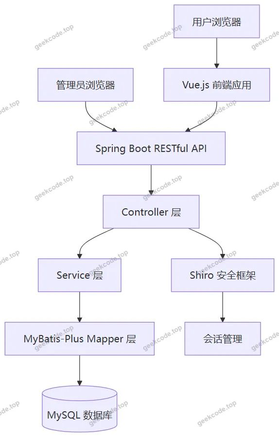</a>

<h3>核心技术选型理由</h3>
<ol>
<li><strong>后端框架 (Spring Boot)</strong>：作为 Java 生态中最流行的微服务基础框架，Spring Boot 提供了自动配置和起步依赖机制，极大地简化了搭建过程，其内置的 Tomcat 容器适合快速部署单体应用。</li>
<li><strong>数据持久层 (MyBatis-Plus)</strong>：在 MyBatis 的基础上增强，提供通用的 CRUD 接口和条件构造器，减少了大量重复 XML 配置文件的编写，提升了开发效率，同时支持复杂的 SQL 优化。</li>
<li><strong>安全框架 (Apache Shiro)</strong>：相比 Spring Security，Shiro 更轻量且易于集成，主要用于处理身份认证、授权、加密和会话管理，能够精准控制前台用户与后台管理员的访问权限。</li>
<li><strong>数据库 (MySQL)</strong>：选用关系型数据库存储结构化数据如用户信息、动漫元数据、评论记录等，保证数据的一致性与完整性。</li>
</ol>
<h3>数据库设计要点</h3>

数据库主要包含以下几类核心实体表：

<ul>
<li><strong>用户相关</strong>：会员表（Huiyuan），存储注册用户的基本信息及账号状态。</li>
<li><strong>内容主体</strong>：热门动漫表（Remendongman）、文章专栏表（Wenzhangzhuanlan）、动漫资讯表（News）、会员分享表（Huiyuanfenxiang）。这些表存储标题、封面图、详情描述、发布时间及分类关联 ID。</li>
<li><strong>互动数据</strong>：论坛信息表（Forum）、各模块对应的评论表（Discussremendongman, Discusswenzhangzhuanlan, Discusshuiyuanfenxiang），存储用户发表的评论内容、时间及关联的主帖 ID。</li>
<li><strong>系统配置</strong>：轮播图表（Config/Dongmanfenlei 辅助配置）、动漫分类表（Dongmanfenlei），用于动态维护首页展示内容及导航结构。</li>
<li><strong>收藏记录</strong>：我的收藏表（Storeup），记录用户与内容之间的多对多收藏关系。</li>
</ul>
<h2>功能模块</h2>

根据源码中的 Controller 列表及路由配置，系统将功能划分为前台用户端和后台管理端两大模块。

<h3>前台用户端功能</h3>

前台面向普通注册会员，提供内容浏览、互动及个人中心服务。

<table>
<thead>
<tr>
<th align="left">模块名称</th>
<th align="left">对应路由/控制器</th>
<th align="left">功能描述</th>
</tr>
</thead>
<tbody><tr>
<td align="left"><strong>首页展示</strong></td>
<td align="left"><code>/index</code> (隐含)</td>
<td align="left">展示轮播图、最新动漫资讯、热门推荐动漫入口，聚合关键信息。</td>
</tr>
<tr>
<td align="left"><strong>热门动漫</strong></td>
<td align="left"><code>RemendongmanController</code></td>
<td align="left">列表页展示热门动漫卡片，详情页展示动漫简介、剧照及评论区。支持按分类筛选。</td>
</tr>
<tr>
<td align="left"><strong>文章专栏</strong></td>
<td align="left"><code>WenzhangzhuanlanController</code></td>
<td align="left">列表页展示深度解析或同人文章，详情页支持阅读正文及发表评论。</td>
</tr>
<tr>
<td align="left"><strong>会员分享</strong></td>
<td align="left"><code>HuiyuanfenxiangController</code></td>
<td align="left">用户提交的原创分享内容列表，详情页展示分享图文及互动评论。</td>
</tr>
<tr>
<td align="left"><strong>动漫资讯</strong></td>
<td align="left"><code>NewsController</code></td>
<td align="left">行业新闻、新番预告等资讯列表与详情展示，侧重时效性信息。</td>
</tr>
<tr>
<td align="left"><strong>论坛信息</strong></td>
<td align="left"><code>ForumController</code></td>
<td align="left">社区讨论区，展示帖子列表，点击可进入详情页查看回复并进行发帖或回帖操作。</td>
</tr>
<tr>
<td align="left"><strong>个人中心</strong></td>
<td align="left"><code>HuiyuanController</code></td>
<td align="left"><strong>我的发布</strong>：查看自己发布的分享或帖子；<strong>我的收藏</strong>：查看已收藏的动漫或文章；<strong>基本资料</strong>：修改头像、昵称、密码等个人信息。</td>
</tr>
<tr>
<td align="left"><strong>注册/登录</strong></td>
<td align="left"><code>CommonController</code> / <code>HuiyuanController</code></td>
<td align="left">新用户注册表单提交，老用户账号密码登录验证。</td>
</tr>
</tbody></table>
<h3>后台管理端功能</h3>

后台面向管理员，提供全量数据的 CRUD（增删改查）管理及系统配置能力。

<table>
<thead>
<tr>
<th align="left">模块名称</th>
<th align="left">对应路由</th>
<th align="left">功能描述</th>
</tr>
</thead>
<tbody><tr>
<td align="left"><strong>用户管理</strong></td>
<td align="left"><code>/huiyuan</code></td>
<td align="left">查看所有注册用户信息，执行启用、禁用或删除账号操作。</td>
</tr>
<tr>
<td align="left"><strong>内容管理 - 热门动漫</strong></td>
<td align="left"><code>/remendongman</code></td>
<td align="left">新增、编辑、删除热门动漫条目，上传图片，设置推荐状态。</td>
</tr>
<tr>
<td align="left"><strong>内容管理 - 文章专栏</strong></td>
<td align="left"><code>/wenzhangzhuanlan</code></td>
<td align="left">管理文章专栏内容，支持富文本编辑，发布或下架文章。</td>
</tr>
<tr>
<td align="left"><strong>内容管理 - 会员分享</strong></td>
<td align="left"><code>/huiyuanfenxiang</code></td>
<td align="left">审核和管理用户提交的分享内容，删除违规信息。</td>
</tr>
<tr>
<td align="left"><strong>内容管理 - 动漫资讯</strong></td>
<td align="left"><code>/news</code></td>
<td align="left">发布和维护官方动漫新闻资讯，更新热点话题。</td>
</tr>
<tr>
<td align="left"><strong>社区管理 - 论坛</strong></td>
<td align="left"><code>/forum</code></td>
<td align="left">查看论坛帖子，管理员可置顶、加精或删除不当言论。</td>
</tr>
<tr>
<td align="left"><strong>评论管理</strong></td>
<td align="left"><code>/discussremendongman</code>,<code>/discusshuiyuanfenxiang</code>,<code>/discusswenzhangzhuanlan</code></td>
<td align="left">分别管理上述三个模块下的用户评论，支持删除恶意评论或敏感词过滤后的清理。</td>
</tr>
<tr>
<td align="left"><strong>分类管理</strong></td>
<td align="left"><code>/dongmanfenlei</code></td>
<td align="left">定义和维护动漫的类型标签（如热血、恋爱、科幻等），供前台筛选使用。</td>
</tr>
<tr>
<td align="left"><strong>收藏管理</strong></td>
<td align="left"><code>/storeup</code></td>
<td align="left">查看全站用户的收藏记录，分析热门内容趋势。</td>
</tr>
<tr>
<td align="left"><strong>系统配置</strong></td>
<td align="left"><code>/config</code></td>
<td align="left">管理首页轮播图片，配置站点基本信息或公告栏内容。</td>
</tr>
</tbody></table>
<h2>用户角色与权限</h2>

系统基于 Apache Shiro 实现严格的角色隔离，主要存在两种角色：<strong>普通用户（会员）<strong>和</strong>系统管理员</strong>。

<h3>1. 普通用户（会员）</h3>
<ul>
<li><strong>权限范围</strong>：仅限前台界面访问。</li>
<li><strong>具体功能权限</strong>：</li>
<li><strong>浏览权限</strong>：可以无限制地浏览所有公开的动漫、文章、资讯、论坛帖子及分类列表。</li>
<li><strong>互动权限</strong>：</li>
<li>登录后可在“热门动漫”、“文章专栏”、“会员分享”详情页发表评论。</li>
<li>可在“论坛信息”中发帖或回复。</li>
<li>可对感兴趣的内容执行“收藏”操作。</li>
<li><strong>个人管理权限</strong>：</li>
<li>注册新账号或使用已有账号登录。</li>
<li>在“个人中心”查看“我的发布”（自己发的帖子或分享）和“我的收藏”。</li>
<li>修改个人资料（头像、昵称、联系方式等）。</li>
<li><strong>限制</strong>：无法访问任何后台管理页面，无法直接修改或删除他人发布的内容，无法进行系统配置。</li>
</ul>
<h3>2. 系统管理员</h3>
<ul>
<li><strong>权限范围</strong>：拥有最高权限，可访问后台管理界面及部分前台调试视图。</li>
<li><strong>具体功能权限</strong>：</li>
<li><strong>全局内容管控</strong>：对所有板块（热门动漫、文章、资讯、分享、论坛）的内容进行创建、读取、更新和删除（CRUD）操作。</li>
<li><strong>用户管理</strong>：查看会员列表，重置密码，冻结或注销违规账号。</li>
<li><strong>评论治理</strong>：监控所有模块下的评论流，具备删除不良评论的权力。</li>
<li><strong>系统运维</strong>：配置首页轮播图，管理动漫分类字典，维护系统基础参数。</li>
<li><strong>数据统计</strong>：通过收藏管理和列表查询，间接掌握平台内容的热度分布。</li>
</ul>
<h2>项目特色与创新点</h2>
<ol>
<li>
<strong>多维度的内容聚合体系</strong>：
   不同于单一的动漫列表网站，本平台创新性地整合了“官方资讯”、“UGC 会员分享”、“专业文章专栏”和“社区论坛”四大内容支柱。这种混合模式既保证了信息的权威性（资讯、专栏），又激发了社区的活跃度（分享、论坛），形成了从“看”到“读”再到“聊”的完整用户行为闭环。

</li>
<li>
<strong>精细化的互动反馈机制</strong>：
   针对不同类型的核心内容（热门动漫、文章、分享），系统设计了独立的评论管理模块（<code>Discuss...Controller</code>）。这意味着不同场景下的用户反馈被结构化存储，便于后台针对性地进行舆情监控和内容质量评估，而非混同在单一的大评论池中，提升了管理的颗粒度。

</li>
<li>
<strong>灵活的前台导航与分类引擎</strong>：
   通过 <code>Dongmanfenlei</code>（动漫分类）和 <code>Config</code>（配置）控制器，实现了前台导航菜单的动态渲染。管理员可以在后台随时调整分类结构和首页轮播内容，无需重新部署代码即可改变前台展示形态，增强了系统的可维护性和运营灵活性。

</li>
<li>
<strong>基于 Shiro 的安全隔离架构</strong>：
   虽然项目规模适中，但引入了专业的安全框架 Shiro 而非简单的拦截器，确保了权限控制的严谨性。特别是在涉及“会员分享”这类 UGC（用户生成内容）场景时，严格区分了发布者与管理者的权限边界，保障了平台内容的安全合规。

</li>
</ol>
<h2>部署环境</h2>

为了确保项目的稳定运行，建议按照以下标准配置服务器及本地开发环境：

<h3>硬件要求</h3>
<ul>
<li><strong>CPU</strong>：Intel Core i5 及以上或同等性能处理器。</li>
<li><strong>内存</strong>：8GB RAM 及以上（建议 16GB 以流畅运行 IDE 及多个中间件）。</li>
<li><strong>硬盘</strong>：至少 20GB 可用空间（用于存放数据库文件、日志及上传的图片资源）。</li>
</ul>
<h3>软件环境</h3>
<ol>
<li><strong>操作系统</strong>：Windows 10/11, macOS, 或 Linux (CentOS 7+, Ubuntu 20.04+)。</li>
<li><strong>Java 开发套件</strong>：</li>
</ol>
<ul>
<li><strong>JDK</strong>：版本 1.8 (Java 8) 或更高版本。需配置 <code>JAVA_HOME</code> 环境变量。</li>
</ul>
<ol start="3">
<li><strong>数据库管理系统</strong>：</li>
</ol>
<ul>
<li><strong>MySQL</strong>：版本 5.7 或 8.0。需初始化数据库并导入相应的 <code>.sql</code> 脚本文件。</li>
</ul>
<ol start="4">
<li><strong>后端构建工具</strong>：</li>
</ol>
<ul>
<li><strong>Maven</strong>：版本 3.6+。用于依赖管理和项目打包。</li>
</ul>
<ol start="5">
<li><strong>前端运行环境</strong>：</li>
</ol>
<ul>
<li><strong>Node.js</strong>：版本 14.x 或 16.x LTS。</li>
<li><strong>npm/yarn</strong>：用于安装前端依赖包及启动 Vue 开发服务器。</li>
</ul>
<ol start="6">
<li><strong>集成开发环境 (IDE)</strong>：</li>
</ol>
<ul>
<li><strong>IntelliJ IDEA</strong> 或 <strong>Eclipse</strong>：用于后端 Java 代码开发与调试。</li>
<li><strong>VS Code</strong> 或 <strong>WebStorm</strong>：用于前端 Vue 代码编辑。</li>
</ul>
<ol start="7">
<li><strong>其他依赖</strong>：</li>
</ol>
<ul>
<li><strong>Tomcat</strong>：通常由 Spring Boot 内置，无需单独安装外部 Tomcat，除非选择 war 包部署方式。</li>
</ul>
<h3>启动流程简述</h3>
<ol>
<li>启动 MySQL 服务，创建数据库并导入数据。</li>
<li>修改后端配置文件（如 <code>application.yml</code> 或 <code>properties</code>）中的数据库连接 URL、用户名和密码。</li>
<li>使用 Maven 命令 <code>mvn clean install</code> 编译后端项目，并通过 IDE 或命令行启动 Spring Boot 主程序。</li>
<li>在前端目录下执行 <code>npm install</code> 安装依赖，随后执行 <code>npm run serve</code> 启动前端开发服务器。</li>
<li>浏览器访问前端默认端口（通常为 8080 或 9527 等，视配置而定）即可进入系统。</li>
</ol>
<h2>五、技术特性</h2>
<ul>
<li>前后端集成部署，前端资源打包至后端 static 目录</li>
<li>使用 MyBatis-Plus 简化数据访问层开发</li>
<li>集成 Shiro 权限框架实现角色权限控制</li>
</ul>
<h2>六、功能模块截图</h2>
<h3>前台用户端</h3>
<h4>前台首页</h4>

<a href="https://geekcode.top/archives/%E5%9C%A8%E7%BA%BF%E5%8A%A8%E6%BC%AB%E4%BF%A1%E6%81%AF%E5%B9%B3%E5%8F%B0?utm_source=github" title="查看完整源码">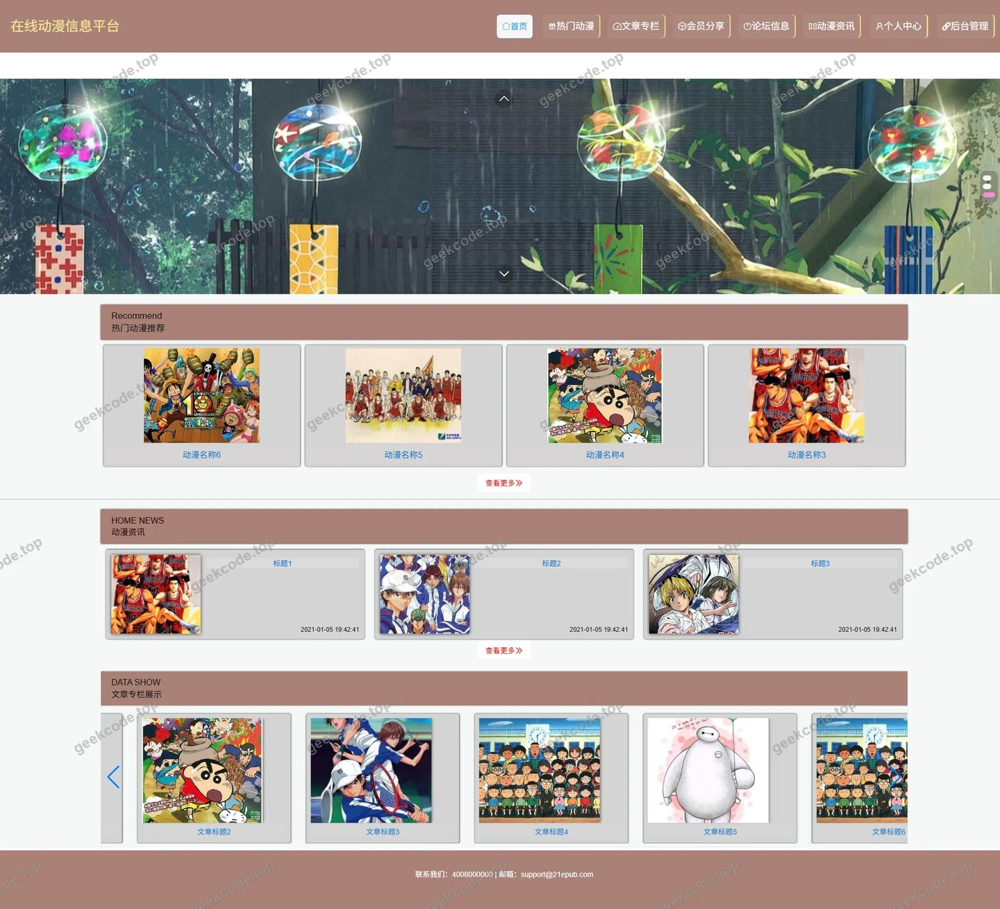</a>

<h4>前台注册页</h4>

<h4>前台登录页</h4>

<h4>前台-论坛信息列表</h4>

<a href="https://geekcode.top/archives/%E5%9C%A8%E7%BA%BF%E5%8A%A8%E6%BC%AB%E4%BF%A1%E6%81%AF%E5%B9%B3%E5%8F%B0?utm_source=github" title="查看完整源码">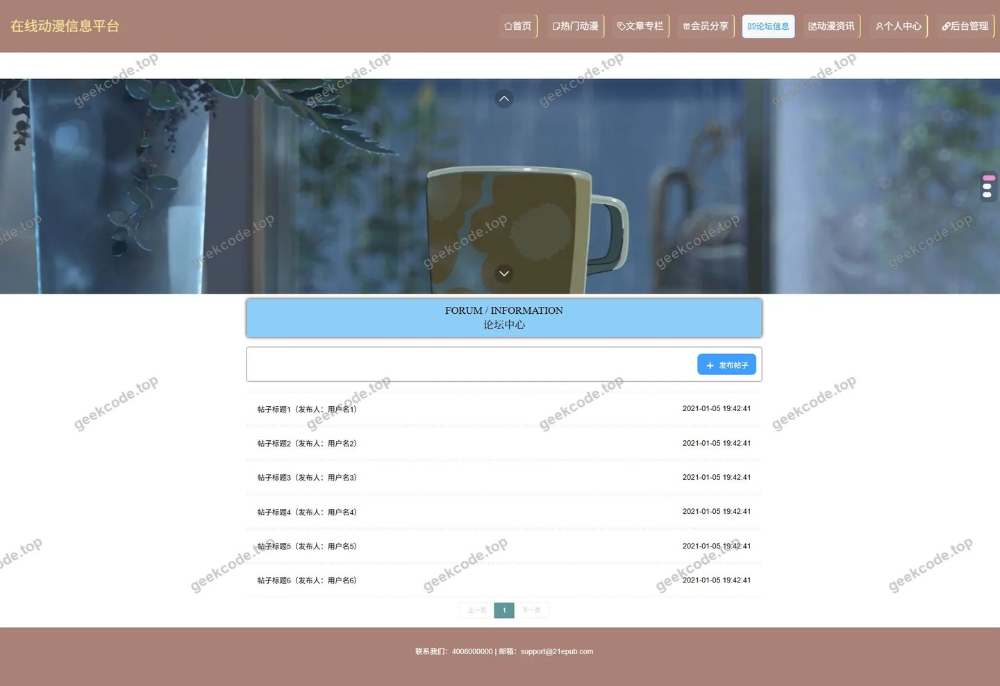</a>

<h4>前台-会员分享列表</h4>

<a href="https://geekcode.top/archives/%E5%9C%A8%E7%BA%BF%E5%8A%A8%E6%BC%AB%E4%BF%A1%E6%81%AF%E5%B9%B3%E5%8F%B0?utm_source=github" title="查看完整源码">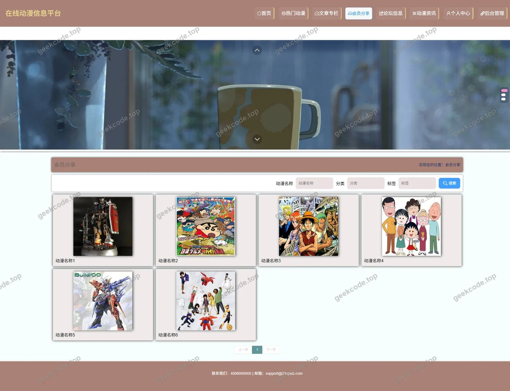</a>

<h4>前台-动漫资讯列表</h4>

<a href="https://geekcode.top/archives/%E5%9C%A8%E7%BA%BF%E5%8A%A8%E6%BC%AB%E4%BF%A1%E6%81%AF%E5%B9%B3%E5%8F%B0?utm_source=github" title="查看完整源码">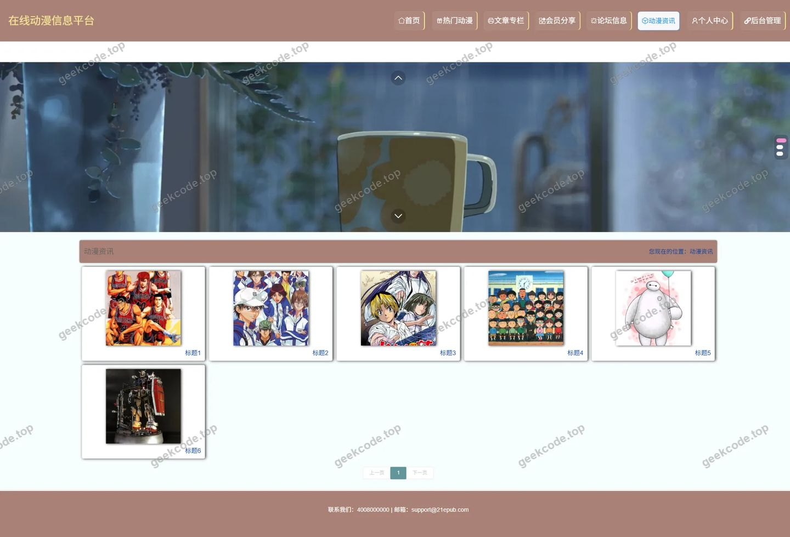</a>

<h4>前台-热门动漫列表</h4>

<a href="https://geekcode.top/archives/%E5%9C%A8%E7%BA%BF%E5%8A%A8%E6%BC%AB%E4%BF%A1%E6%81%AF%E5%B9%B3%E5%8F%B0?utm_source=github" title="查看完整源码">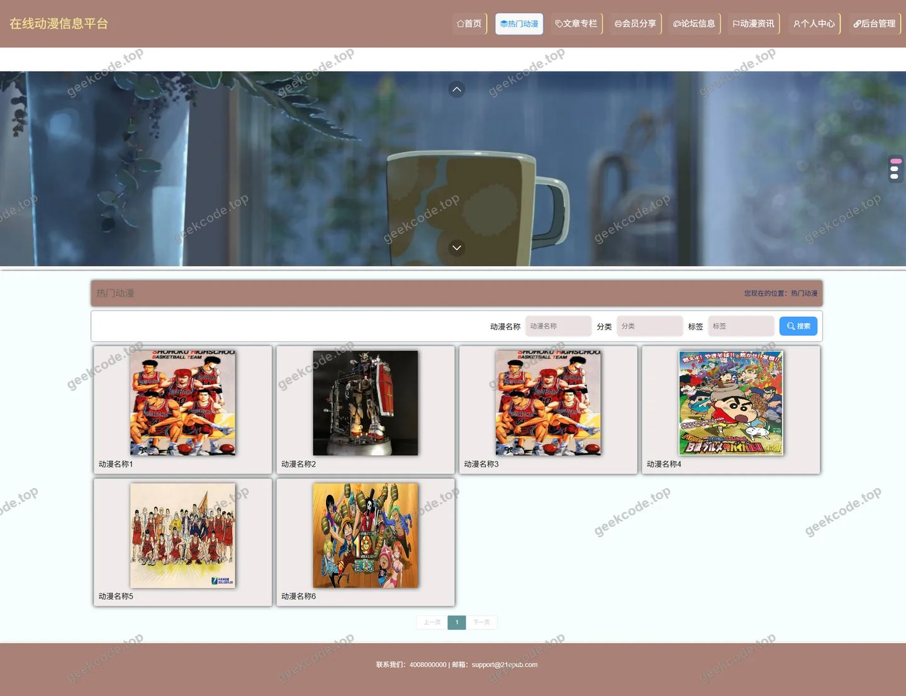</a>

<h4>前台-文章专栏列表</h4>

<a href="https://geekcode.top/archives/%E5%9C%A8%E7%BA%BF%E5%8A%A8%E6%BC%AB%E4%BF%A1%E6%81%AF%E5%B9%B3%E5%8F%B0?utm_source=github" title="查看完整源码">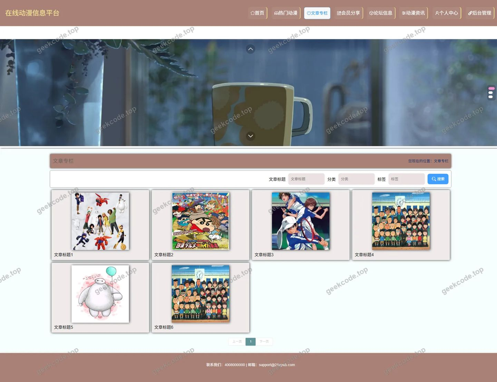</a>

<h4>前台-会员分享评论列表</h4>

<a href="https://geekcode.top/archives/%E5%9C%A8%E7%BA%BF%E5%8A%A8%E6%BC%AB%E4%BF%A1%E6%81%AF%E5%B9%B3%E5%8F%B0?utm_source=github" title="查看完整源码">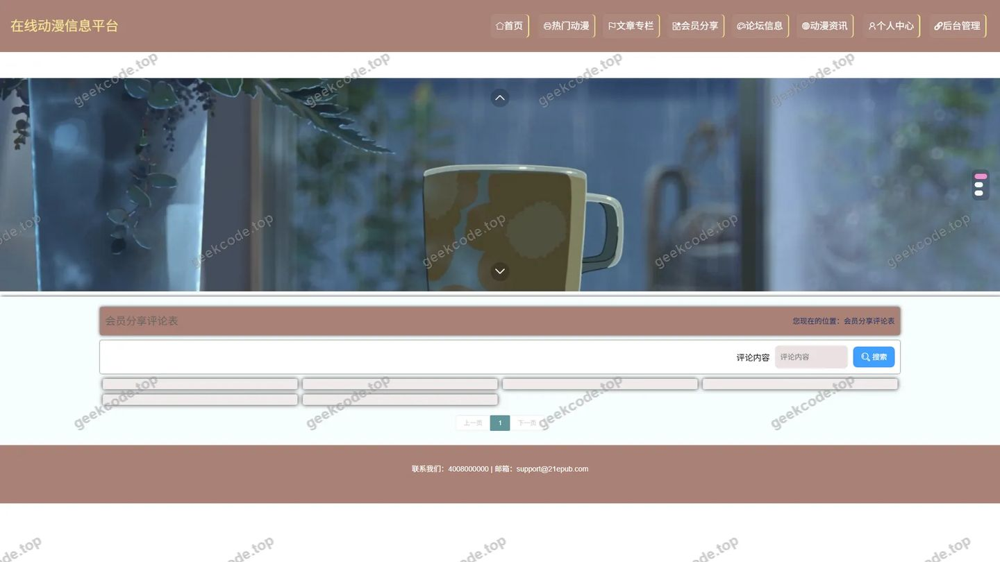</a>

<h4>前台-热门动漫评论列表</h4>

<a href="https://geekcode.top/archives/%E5%9C%A8%E7%BA%BF%E5%8A%A8%E6%BC%AB%E4%BF%A1%E6%81%AF%E5%B9%B3%E5%8F%B0?utm_source=github" title="查看完整源码">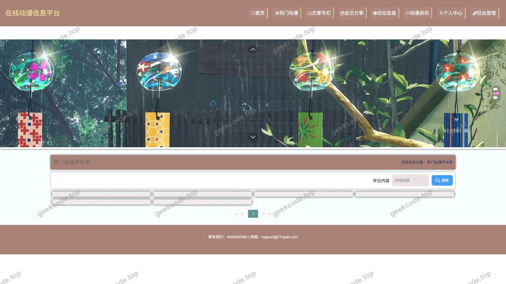</a>

<h4>前台-文章专栏评论列表</h4>

<h4>前台个人中心</h4>

<a href="https://geekcode.top/archives/%E5%9C%A8%E7%BA%BF%E5%8A%A8%E6%BC%AB%E4%BF%A1%E6%81%AF%E5%B9%B3%E5%8F%B0?utm_source=github" title="查看完整源码">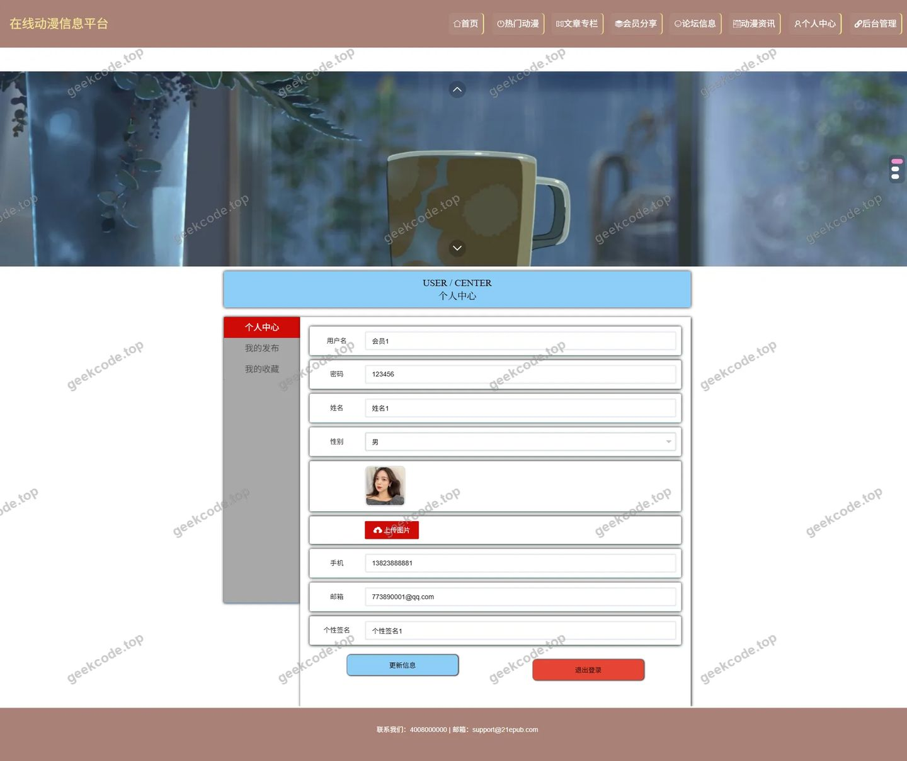</a>

<h4>前台-我的收藏列表</h4>

<a href="https://geekcode.top/archives/%E5%9C%A8%E7%BA%BF%E5%8A%A8%E6%BC%AB%E4%BF%A1%E6%81%AF%E5%B9%B3%E5%8F%B0?utm_source=github" title="查看完整源码">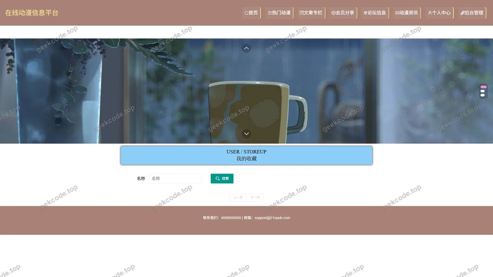</a>

<h4>前台-论坛信息-详情</h4>

<a href="https://geekcode.top/archives/%E5%9C%A8%E7%BA%BF%E5%8A%A8%E6%BC%AB%E4%BF%A1%E6%81%AF%E5%B9%B3%E5%8F%B0?utm_source=github" title="查看完整源码">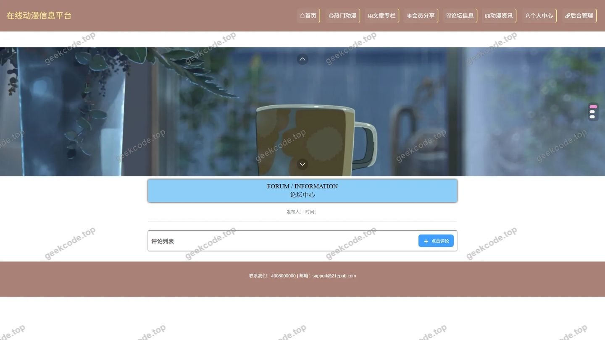</a>

<h4>前台-会员分享-详情</h4>

<a href="https://geekcode.top/archives/%E5%9C%A8%E7%BA%BF%E5%8A%A8%E6%BC%AB%E4%BF%A1%E6%81%AF%E5%B9%B3%E5%8F%B0?utm_source=github" title="查看完整源码">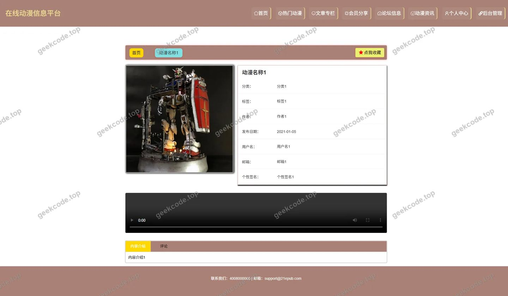</a>

<h4>前台-动漫资讯-详情</h4>

<a href="https://geekcode.top/archives/%E5%9C%A8%E7%BA%BF%E5%8A%A8%E6%BC%AB%E4%BF%A1%E6%81%AF%E5%B9%B3%E5%8F%B0?utm_source=github" title="查看完整源码">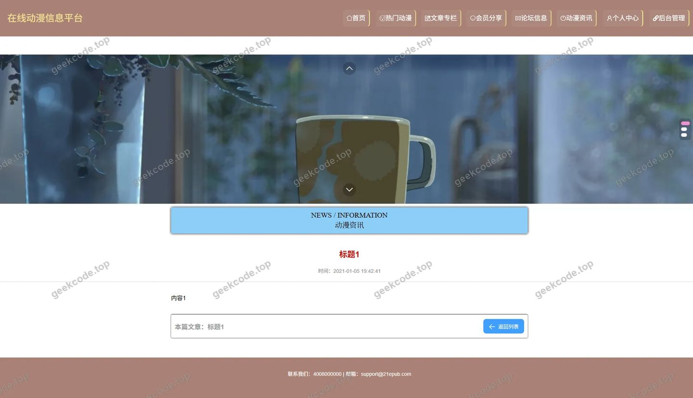</a>

<h4>前台-热门动漫-详情</h4>

<a href="https://geekcode.top/archives/%E5%9C%A8%E7%BA%BF%E5%8A%A8%E6%BC%AB%E4%BF%A1%E6%81%AF%E5%B9%B3%E5%8F%B0?utm_source=github" title="查看完整源码">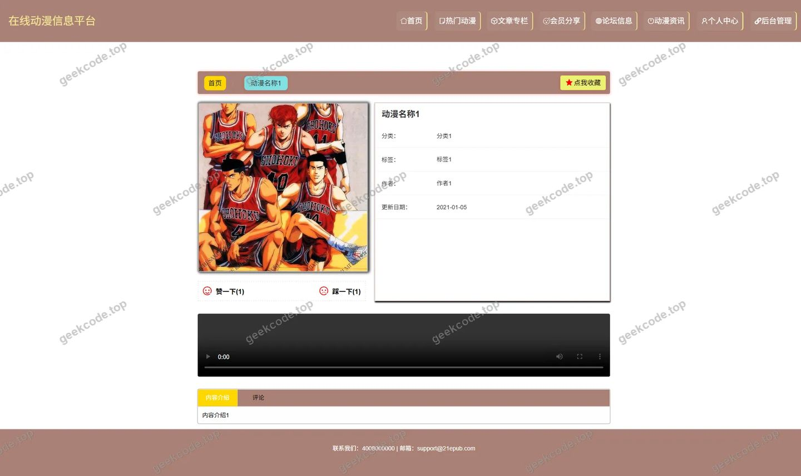</a>

<h4>前台-文章专栏-详情</h4>

<a href="https://geekcode.top/archives/%E5%9C%A8%E7%BA%BF%E5%8A%A8%E6%BC%AB%E4%BF%A1%E6%81%AF%E5%B9%B3%E5%8F%B0?utm_source=github" title="查看完整源码">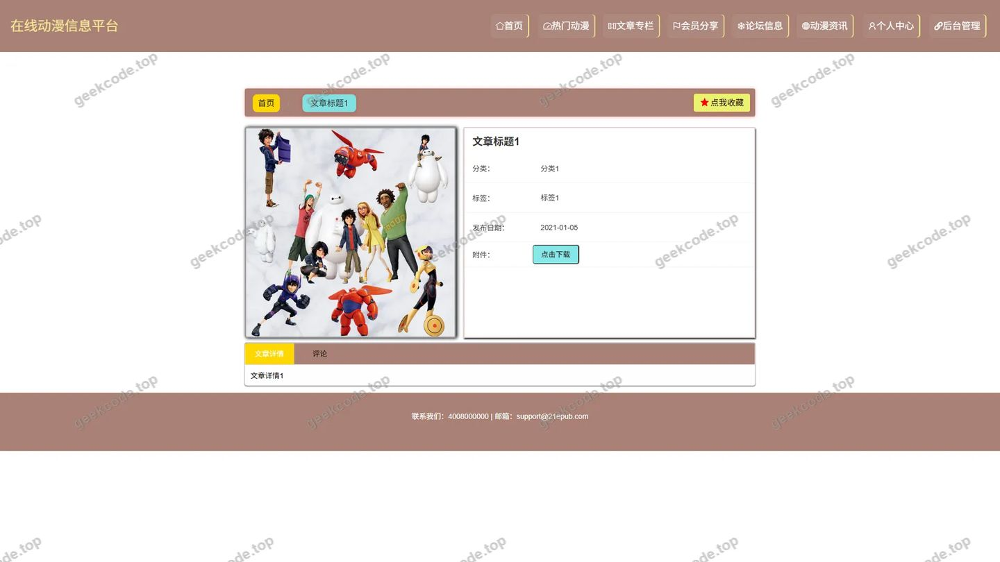</a>

<h4>前台-动漫分类列表</h4>

<a href="https://geekcode.top/archives/%E5%9C%A8%E7%BA%BF%E5%8A%A8%E6%BC%AB%E4%BF%A1%E6%81%AF%E5%B9%B3%E5%8F%B0?utm_source=github" title="查看完整源码">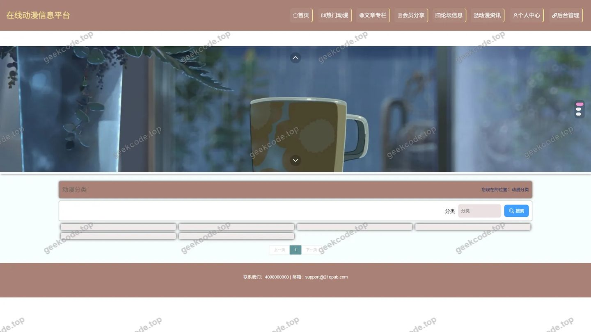</a>

<h4>前台-会员分享评论-详情</h4>

<h4>前台-热门动漫评论-详情</h4>

<a href="https://geekcode.top/archives/%E5%9C%A8%E7%BA%BF%E5%8A%A8%E6%BC%AB%E4%BF%A1%E6%81%AF%E5%B9%B3%E5%8F%B0?utm_source=github" title="查看完整源码">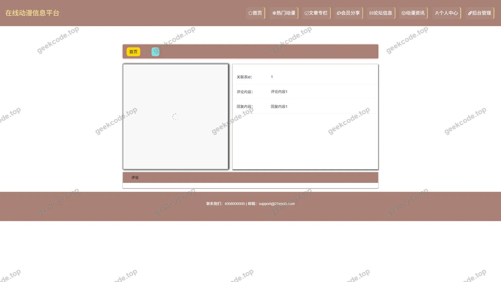</a>

<h4>前台-文章专栏评论-详情</h4>

<a href="https://geekcode.top/archives/%E5%9C%A8%E7%BA%BF%E5%8A%A8%E6%BC%AB%E4%BF%A1%E6%81%AF%E5%B9%B3%E5%8F%B0?utm_source=github" title="查看完整源码">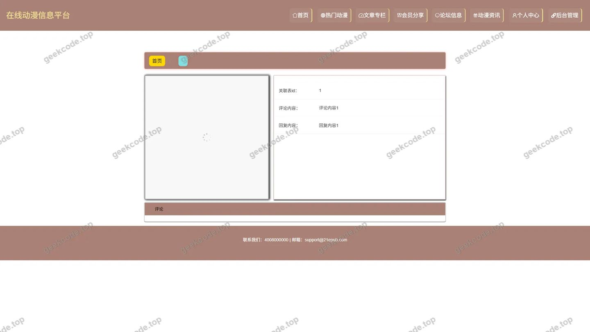</a>

<h4>前台-动漫分类-详情</h4>

<a href="https://geekcode.top/archives/%E5%9C%A8%E7%BA%BF%E5%8A%A8%E6%BC%AB%E4%BF%A1%E6%81%AF%E5%B9%B3%E5%8F%B0?utm_source=github" title="查看完整源码">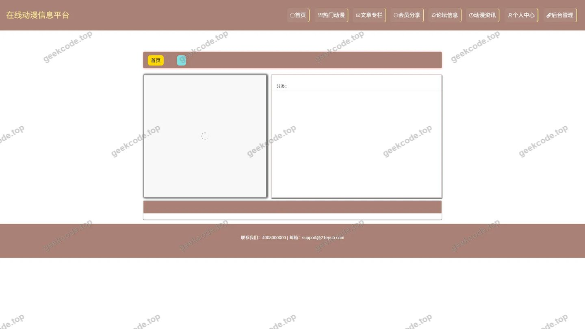</a>

<h3>后台管理端</h3>
<h4>后台-系统配置</h4>

<a href="https://geekcode.top/archives/%E5%9C%A8%E7%BA%BF%E5%8A%A8%E6%BC%AB%E4%BF%A1%E6%81%AF%E5%B9%B3%E5%8F%B0?utm_source=github" title="查看完整源码">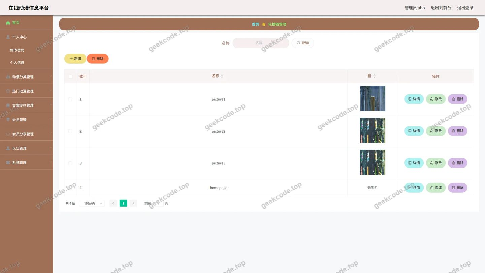</a>

<h4>后台-会员分享评论</h4>

<h4>后台-热门动漫评论</h4>

<a href="https://geekcode.top/archives/%E5%9C%A8%E7%BA%BF%E5%8A%A8%E6%BC%AB%E4%BF%A1%E6%81%AF%E5%B9%B3%E5%8F%B0?utm_source=github" title="查看完整源码">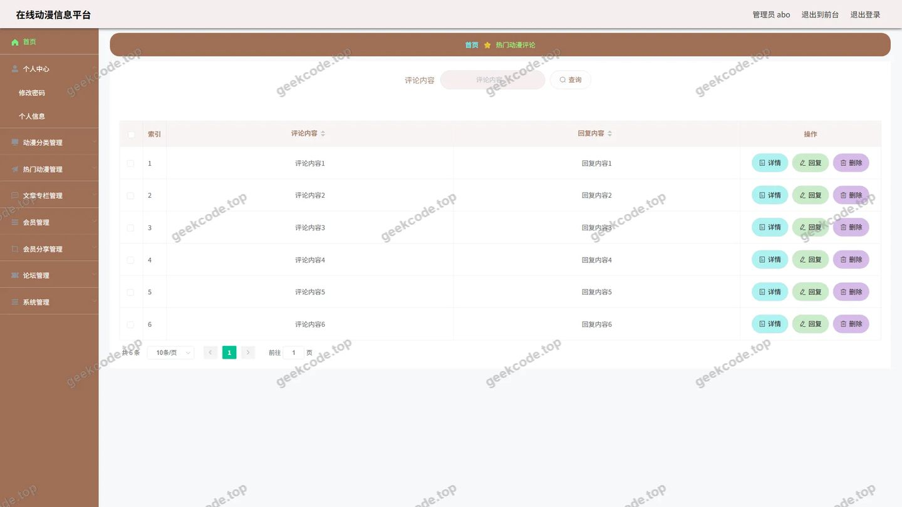</a>

<h4>后台-文章专栏评论</h4>

<h4>后台-动漫分类</h4>

<a href="https://geekcode.top/archives/%E5%9C%A8%E7%BA%BF%E5%8A%A8%E6%BC%AB%E4%BF%A1%E6%81%AF%E5%B9%B3%E5%8F%B0?utm_source=github" title="查看完整源码">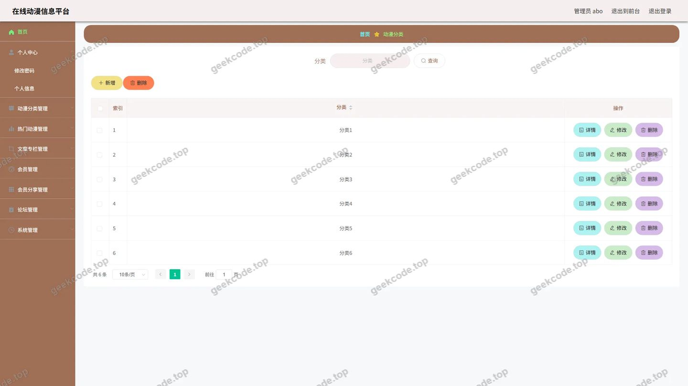</a>

<h4>后台-论坛</h4>

<a href="https://geekcode.top/archives/%E5%9C%A8%E7%BA%BF%E5%8A%A8%E6%BC%AB%E4%BF%A1%E6%81%AF%E5%B9%B3%E5%8F%B0?utm_source=github" title="查看完整源码">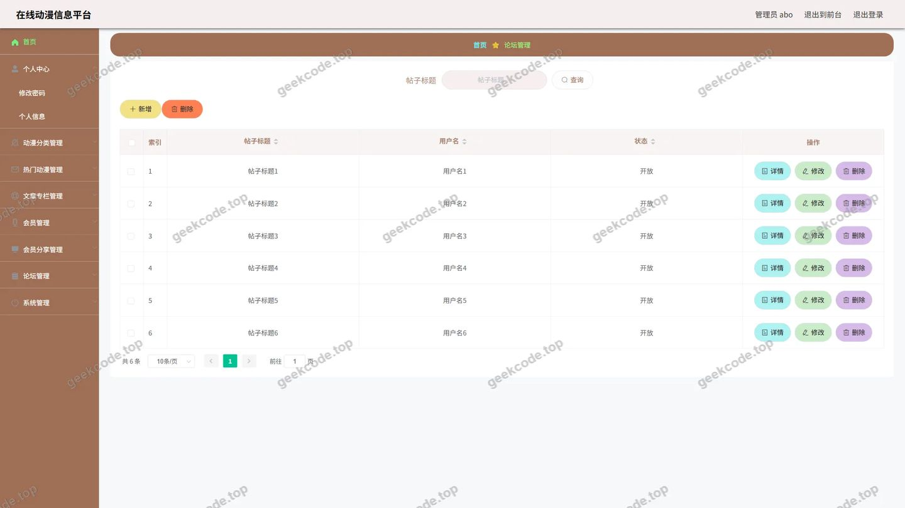</a>

<h4>后台首页</h4>

<a href="https://geekcode.top/archives/%E5%9C%A8%E7%BA%BF%E5%8A%A8%E6%BC%AB%E4%BF%A1%E6%81%AF%E5%B9%B3%E5%8F%B0?utm_source=github" title="查看完整源码">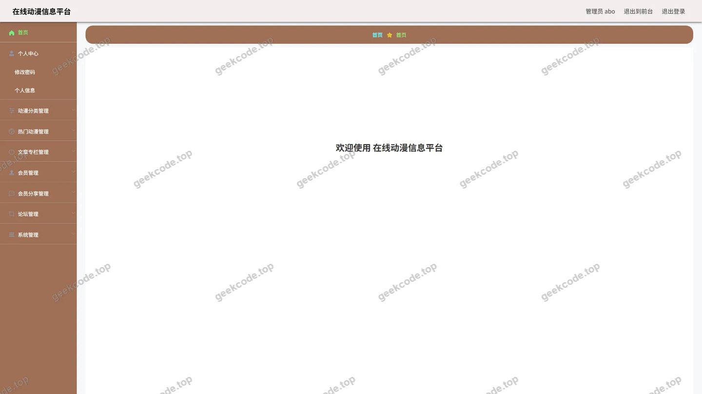</a>

<h4>后台-会员</h4>

<a href="https://geekcode.top/archives/%E5%9C%A8%E7%BA%BF%E5%8A%A8%E6%BC%AB%E4%BF%A1%E6%81%AF%E5%B9%B3%E5%8F%B0?utm_source=github" title="查看完整源码">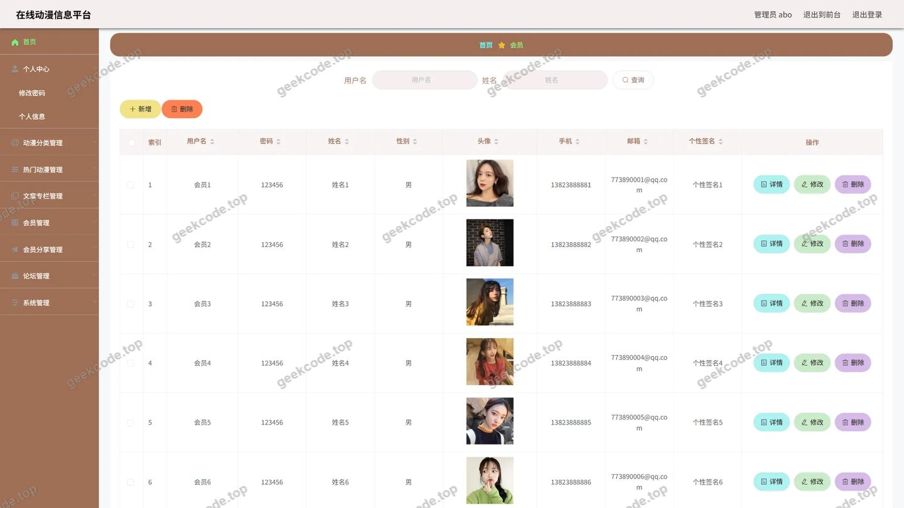</a>

<h4>后台-会员分享</h4>

<a href="https://geekcode.top/archives/%E5%9C%A8%E7%BA%BF%E5%8A%A8%E6%BC%AB%E4%BF%A1%E6%81%AF%E5%B9%B3%E5%8F%B0?utm_source=github" title="查看完整源码">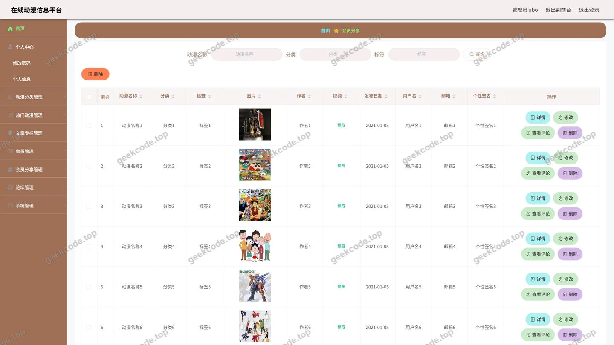</a>

<h4>后台-登录</h4>

<a href="https://geekcode.top/archives/%E5%9C%A8%E7%BA%BF%E5%8A%A8%E6%BC%AB%E4%BF%A1%E6%81%AF%E5%B9%B3%E5%8F%B0?utm_source=github" title="查看完整源码">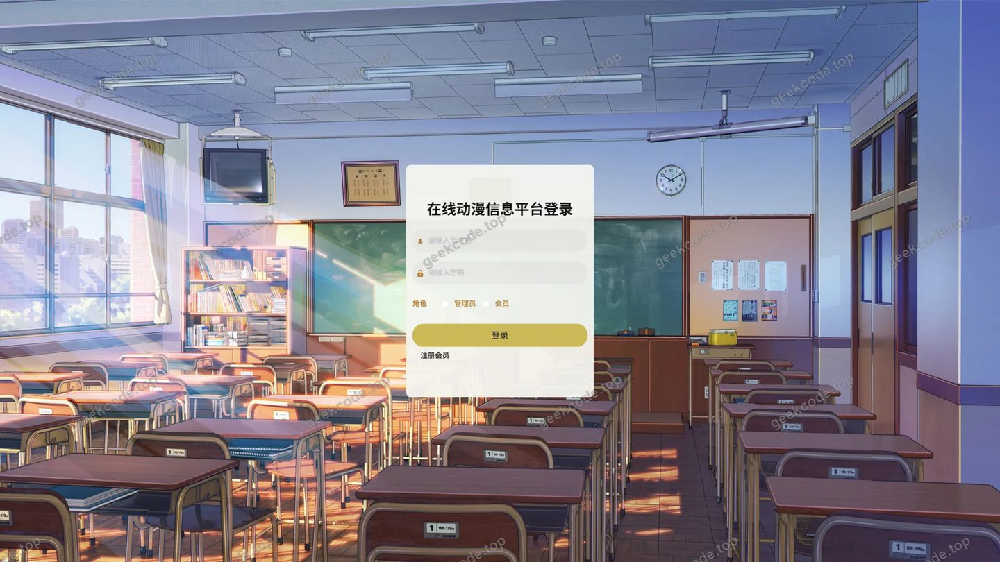</a>

<h4>后台-公告信息</h4>

<a href="https://geekcode.top/archives/%E5%9C%A8%E7%BA%BF%E5%8A%A8%E6%BC%AB%E4%BF%A1%E6%81%AF%E5%B9%B3%E5%8F%B0?utm_source=github" title="查看完整源码">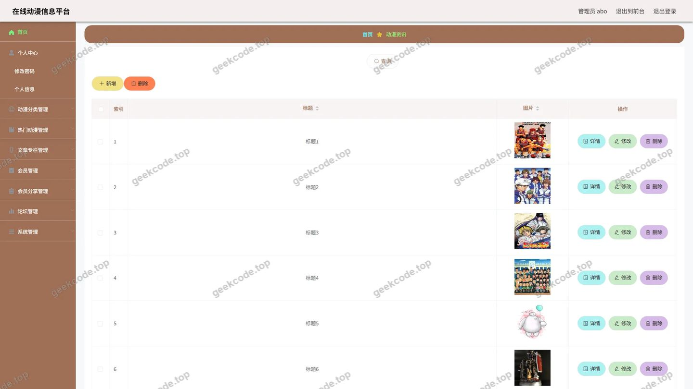</a>

<h4>后台-热门动漫</h4>

<a href="https://geekcode.top/archives/%E5%9C%A8%E7%BA%BF%E5%8A%A8%E6%BC%AB%E4%BF%A1%E6%81%AF%E5%B9%B3%E5%8F%B0?utm_source=github" title="查看完整源码">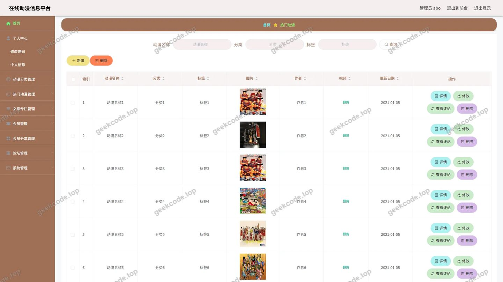</a>

<h4>后台-收藏</h4>

<a href="https://geekcode.top/archives/%E5%9C%A8%E7%BA%BF%E5%8A%A8%E6%BC%AB%E4%BF%A1%E6%81%AF%E5%B9%B3%E5%8F%B0?utm_source=github" title="查看完整源码">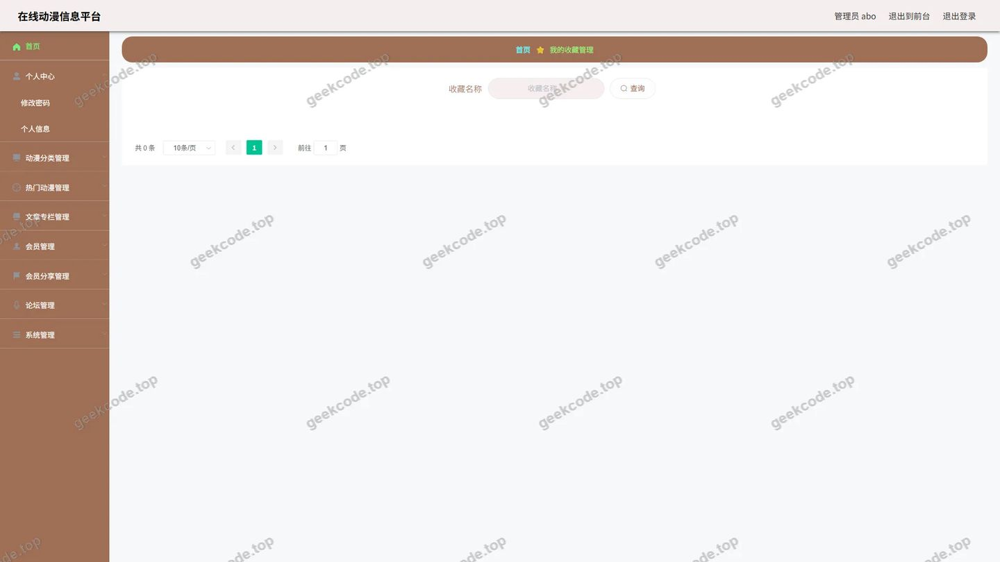</a>

<h4>后台-文章专栏</h4>

<a href="https://geekcode.top/archives/%E5%9C%A8%E7%BA%BF%E5%8A%A8%E6%BC%AB%E4%BF%A1%E6%81%AF%E5%B9%B3%E5%8F%B0?utm_source=github" title="查看完整源码">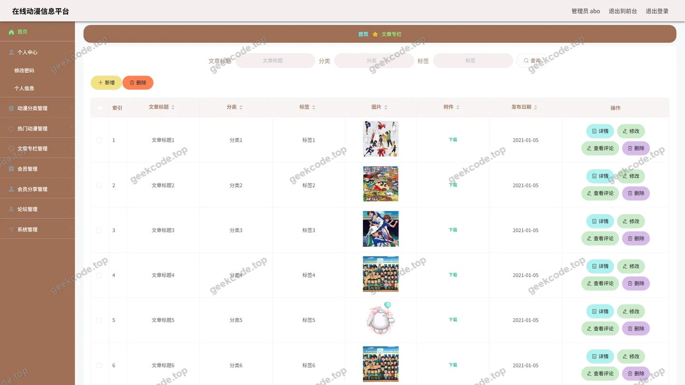</a>

---

## 获取完整源码

| 项目 | 说明 |
| --- | --- |
| 项目名 | 在线动漫信息平台 |
| 运行截图 | 本文 38 张（站点带水印原图，仓库 `images/` 目录） |
| 完整源码 | [https://geekcode.top/archives/%E5%9C%A8%E7%BA%BF%E5%8A%A8%E6%BC%AB%E4%BF%A1%E6%81%AF%E5%B9%B3%E5%8F%B0?utm_source=github](https://geekcode.top/archives/%E5%9C%A8%E7%BA%BF%E5%8A%A8%E6%BC%AB%E4%BF%A1%E6%81%AF%E5%B9%B3%E5%8F%B0?utm_source=github) |
| 咨询微信 | **ir9372**（备注：jingpin-yuanma） |
| 更多项目 | [极客代码 geekcode.top](https://geekcode.top/?utm_source=github) |

> 需要源码、部署、改配置、跑不起来等问题，加微信 ir9372 沟通，说明项目名即可。
